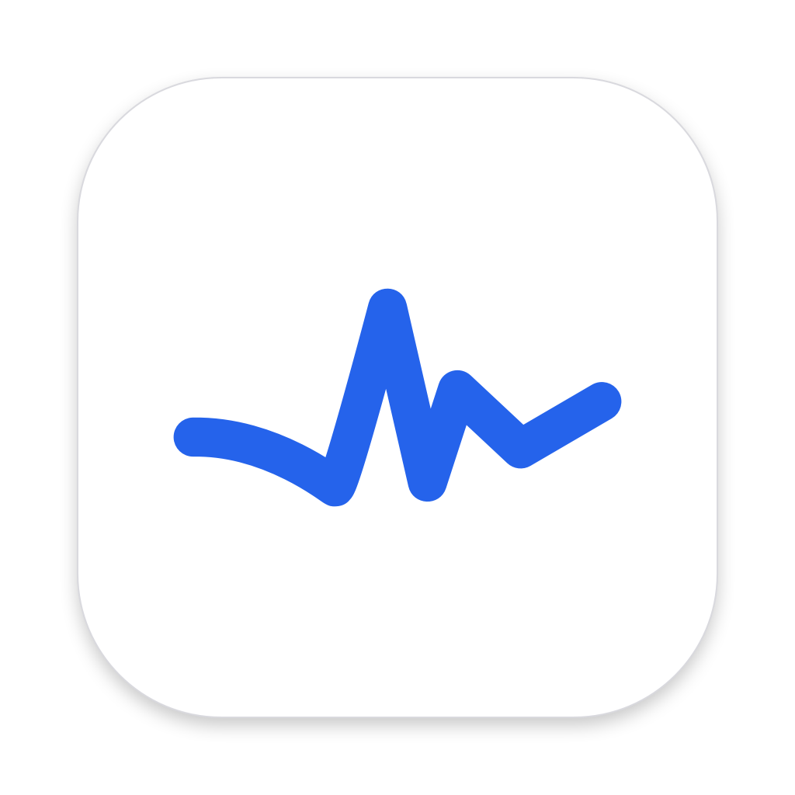
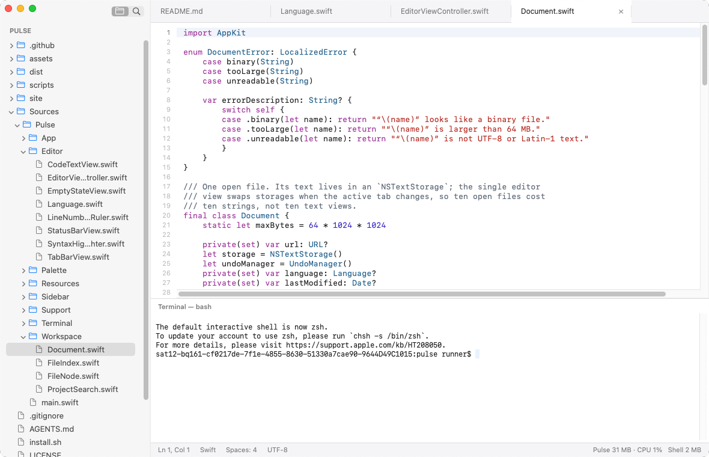

<div align="center">



# Pulse

**A light, native code editor for macOS.**

<br />

<picture>
  <source srcset="assets/screenshot-dark.png" media="(prefers-color-scheme: dark)" />
  
</picture>

[](https://github.com/Suraj1089/pulse)
[](https://swift.org)
[](LICENSE)
[](https://github.com/Suraj1089/pulse/actions/workflows/ci.yml)

[**Download Pulse.dmg**](https://github.com/Suraj1089/pulse/releases/latest/download/Pulse.dmg) • [**Website**](https://pulse0.app)

</div>

---

Pulse is a code editor written in Swift and AppKit, with no web view, no Electron and no extension host. Its goal is to stay small: **50–60 MB of memory in normal use, and never more than 100 MB**, with no CPU use while you are not typing.

## Features

- **Folders and files**: open a folder, browse it in the sidebar, open many files in tabs.
- **Windows**: each folder opens in its own window (`pulse <folder>`, Finder, File › Open), like VS Code; opening a folder that is already open brings its window forward. ⇧⌘N opens an empty window. All windows come back after a restart.
- **Editing**: syntax highlighting for Swift, JS/TS, Python, Go, Rust, C/C++/Obj-C, Java/Kotlin, Ruby, shell, HTML/XML, CSS, JSON, YAML, TOML, Markdown and SQL. Line numbers, current-line highlight, auto-indent, toggle comment, indent/outdent, word wrap.
- **Breadcrumbs**: the open file's path, from the opened folder, shows under the tabs.
- **Find and replace** in the file (the standard macOS find bar), and **project search** (uses `ripgrep` when installed, otherwise a built-in scan; a block of code finds the same code however it is wrapped or indented).
- **Command palette**: `⌘P` go to file, `⇧⌘P` commands, `⌘L` go to line.
- **Integrated terminal** (`` ⌃` ``), started only when you first open it.
- **Claude Code knows what you're looking at**: run `claude` in Pulse's terminal and it sees the open file and your selection ("⧉ 5 lines selected"), as in VS Code. `⇧⌘K` puts `@file#L5-9` in Claude's prompt. From another terminal, run `/ide` and pick Pulse. It costs nothing until Claude connects; View › Share Selection with Claude Code turns it off.
- **Autosave and session recovery**: files save themselves a second after you stop typing, and Pulse reopens your folder, tabs and any unsaved buffers after you quit.
- **Honest resource meter**: the status bar shows Pulse's own memory and CPU, with the terminal's shell measured separately.

Not included, on purpose: extensions, debugger, AI features, telemetry.

## Install

```sh
curl -fsSL https://pulse0.app/install.sh | bash
```

Or download [Pulse.dmg](https://github.com/Suraj1089/pulse/releases/latest/download/Pulse.dmg) and drag Pulse to Applications.

Open a folder from the terminal with `pulse .` (or `pulse file.swift src/`), like VS Code's `code .`. Pulse links the `pulse` command into a folder on your PATH the first time it runs; if that needs a password, use Pulse › Install 'pulse' Command. Homebrew installs it with the cask.

If installing from Pulse doesn't work, link it yourself (asks for your password once):

```sh
sudo mkdir -p /usr/local/bin && sudo ln -sf /Applications/Pulse.app/Contents/Resources/pulse /usr/local/bin/pulse
```

In Source Control, click a changed file to see its diff (added and removed lines with old and new line numbers, like GitHub); double-click opens the file.

The editor, the sidebar and the terminal each have their own font size: ⌘+ / ⌘− / ⌘0 change the one you're working in, and View › Font Size names each. View › Appearance picks Auto, Light or Dark. The Welcome tab (Help › Welcome to Pulse) opens the first time Pulse runs.

Pulse checks for a new release once a day and shows an **Update** button at the top right when one is available; it installs the update and reopens with your tabs. Pulse › Check for Updates… checks right away. Releases are published from `main` when a commit or merged PR title includes `[release]`.

## Shortcuts

| Shortcut | Action |
| :--- | :--- |
| `⌘O` | Open a folder or files |
| `⇧⌘N` | New window |
| `⌘P` | Go to file |
| `⇧⌘P` | Command palette |
| `⌘L` | Go to line |
| `⌘F` / `⌥⌘F` | Find / find and replace in file |
| `⇧⌘F` | Search the project |
| `` ⌃` `` | Show or hide the terminal |
| `⌃⇧`` ` | New terminal (in the open folder) |
| `⌘\` | Split terminal (side by side) |
| `⇧⌘K` | Send the selection to Claude Code (`@file#L5-9` in its prompt) |
| `⌘/` | Toggle line comment |
| `⌘]` / `⌘[` | Indent / outdent |
| `⇧⌘]` / `⇧⌘[` | Next / previous tab |
| `⌃⌘S` | Toggle sidebar |
| `⌘+` / `⌘-` / `⌘0` | Font size of the editor, sidebar or terminal (whichever has focus) |

## Memory budget

| Scenario | Measured in CI | Target | Hard limit |
| :--- | :--- | :--- | :--- |
| Empty window | **15.0 MB** | ≤ 40 MB | 100 MB |
| Ten files open | **31.8 MB** | ≤ 60 MB | 100 MB |
| Ten files + terminal | **31.0 MB** (+1.8 MB shell) | ≤ 60 MB | 100 MB |

"Memory" means physical footprint, the number Activity Monitor shows, read with `vmmap` 8 seconds after launch on GitHub's macOS 14 runner. Shells and other processes you start in the terminal are reported separately. CI measures all three scenarios on every push and fails the build above 100 MB (`scripts/memory-check.sh`). It also captures real screenshots of the build (`scripts/screenshot.sh`), which is where the image above comes from.

How it stays small:

- One text view for all tabs. Switching tabs swaps the layout manager onto another document's text, so each extra file costs roughly its own text.
- Syntax colors are layout-manager temporary attributes: no copies of the text, no relayout. Files over 300 KB are highlighted around the visible area only.
- The file tree reads a folder only when you expand it. The go-to-file index is built on first use.
- The terminal view and shell are created the first time you open the terminal.
- Nothing polls in the background. The resource meter samples every 2 s only while Pulse is the active app.

## Build from source

Requirements: macOS 14+, Xcode 15+ (Swift 5.9+).

```sh
git clone https://github.com/Suraj1089/pulse.git
cd pulse

swift run Pulse .                    # run from source, opening this folder
./scripts/bundle.sh                  # build dist/Pulse.app for this Mac
open dist/Pulse.app
./scripts/memory-check.sh            # measure the memory budget locally
./scripts/package.sh                 # universal release build: DMG, ZIP, Homebrew cask
```

## License

MIT. See [`LICENSE`](LICENSE).
